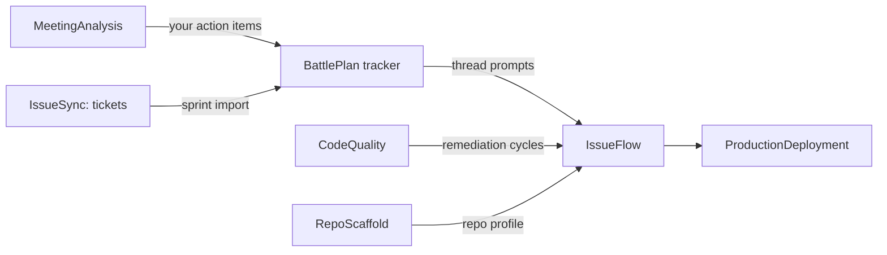

# agent-workday-skills

Skills for the parts of a developer's day that an AI agent can carry end to end: planning the
day, turning meetings into tracked work, and taking an issue from ticket to merged PR with hard
human gates. Built for [Claude Code](https://docs.claude.com/en/docs/claude-code/skills) and
written to the open `SKILL.md` format, so other agents that read skills (OpenAI Codex CLI,
Gemini CLI, Cursor, OpenCode and others) can use them too.

Nothing here knows your company, your stack or your people. Every skill starts with a
**Setup** workflow that writes that knowledge into a config file you own, outside the repo.

## The three families

| Family | Skills | What it does |
| --- | --- | --- |
| **Planning** | `BattlePlan` | Reads open tasks from a tracker (local CSV, an Excel workbook, or a Google Sheet), recaps yesterday's agent sessions and git commits, audits what is really done, and writes a plan of parallel threads with starting prompts. End-of-day handoff and an unattended morning draft |
| **Meetings** | `MeetingAnalysis` | Transcribes recordings locally (faster-whisper: CUDA, Apple Silicon or CPU) or imports Google Meet / Gemini notes or pasted notetaker transcripts; writes a structured summary; pushes only *your* action items into BattlePlan. Optional unattended inbox: drop a recording, get a summary |
| **Issue lifecycle** | `IssueFlow`, `IssueSync`, `ProductionDeployment`, `RepoScaffold`, `CodeQuality` | One issue end to end in an isolated git worktree with its own ports: plan → implement until unit + full e2e + CI-parity preflight are green → developer gate → PR, preview, tracker comment → stakeholder gate → rebase, re-validate, merge, clean up. Tracker adapters (Jira; add Linear, GitHub, Azure as folders), release promotion with an env-parity matrix, repo scaffolding, and a code-quality scan + fix loop that feeds remediation cycles |



## Install

```bash
git clone https://github.com/juanmherrerav/agent-workday-skills.git
cd agent-workday-skills
./install.sh                    # Claude Code (~/.claude/skills), as symlinks: `git pull` updates them
./install.sh --agent codex      # OpenAI Codex CLI
./install.sh --agent agents     # ~/.agents/skills
./install.sh --target DIR       # anything else that reads SKILL.md folders
```

If the skills live anywhere other than `~/.claude/skills`, set `SKILLS_HOME` to that directory:
the workflows call their tools through `${SKILLS_HOME:-$HOME/.claude/skills}`.

**Requirements:** `bash`, `git`, [`uv`](https://docs.astral.sh/uv/) (every Python tool is a
self-contained `uv run --script` with inline dependencies), and per skill: `gh` for IssueFlow on
GitHub, `ffmpeg` only for meeting frame extraction.

## Setup: where your specifics live

| Skill | Setup | Writes |
| --- | --- | --- |
| BattlePlan | "set up battleplan" | `~/.config/agent-skills/BattlePlan/config.json`: owner, tracker backend, contexts and sub-contexts, plans folder |
| MeetingAnalysis | "set up meeting analysis" | `~/.config/agent-skills/MeetingAnalysis/config.json`: meeting folders, recordings archive (outside git), notes provider, roster |
| IssueFlow family | "set up issueflow for this repo" (or "make this repo agent-ready" for RepoScaffold) | `<repo>/.claude/workflow-profile.sh`: issue key pattern, branches, worktree ports, setup / unit / e2e / preflight / serve commands, preview provider, stakeholder gate |
| CodeQuality | "install quality tools" | the repo's linters, type checkers and scanners from a manifest of free local tools |

`AGENT_SKILLS_CONFIG` moves the config root. Optional per-skill personal preferences go in
`~/.config/agent-skills/<Skill>/PREFERENCES.md`.

## Tracker backends (BattlePlan)

| Backend | Good for | Notes |
| --- | --- | --- |
| `csv` | zero accounts, plain files, version control | one `<Tab>.csv` per tab; share via git or any synced folder |
| `xlsx` | Excel users, OneDrive / SharePoint | one workbook; close it in Excel while tools write |
| `gsheets` | browser and phone editing | Google service account with editor access |

Every tracker write is a deterministic script with JSON output and `--dry-run`; imports are
idempotent, so re-running a meeting import never duplicates tasks.

## Design rules the skills share

- **Deterministic tools, judgment in the workflow.** Scripts do the parts that must be exact
  (rows, worktrees, ports, transcripts); the agent does classification, summaries and plans.
- **Hard human gates.** No task is marked done from evidence alone, no PR merges without the
  named approval, nothing launches without confirmation.
- **No product detail in a skill.** Repos hold their profile; users hold their config.
- **Recordings never enter a git repo.** Checked by config validation and by a verification step.
- **Confidential contexts.** Mark a context confidential and tracker text, handoffs and summaries
  carry ticket IDs and generic wording only; the tools reject IPs, URLs and your own patterns.

## Agent compatibility

| Capability | Claude Code | Other SKILL.md agents |
| --- | --- | --- |
| All workflows and tools | yes | yes (the tools are plain bash / Python) |
| Session recap in BattlePlan | reads Claude Code transcripts | git commits and handoffs only |
| Unattended runs (morning draft, meeting inbox) | `claude -p` with a read-only allowlist | set `BATTLEPLAN_AGENT_CMD` / `MEETING_AGENT_CMD` to your agent's headless command |
| Meeting notes import | claude.ai Google Drive / Docs connectors | any MCP server exposing Drive and Docs read tools (configure `ingest.allowed_tools`) |

## Development

```bash
cd skills/BattlePlan && uv run --with pytest --with openpyxl pytest tests/
bash -n skills/*/Tools/*.sh
```

## License

MIT © 2026 Juan Herrera. See [LICENSE](LICENSE).
